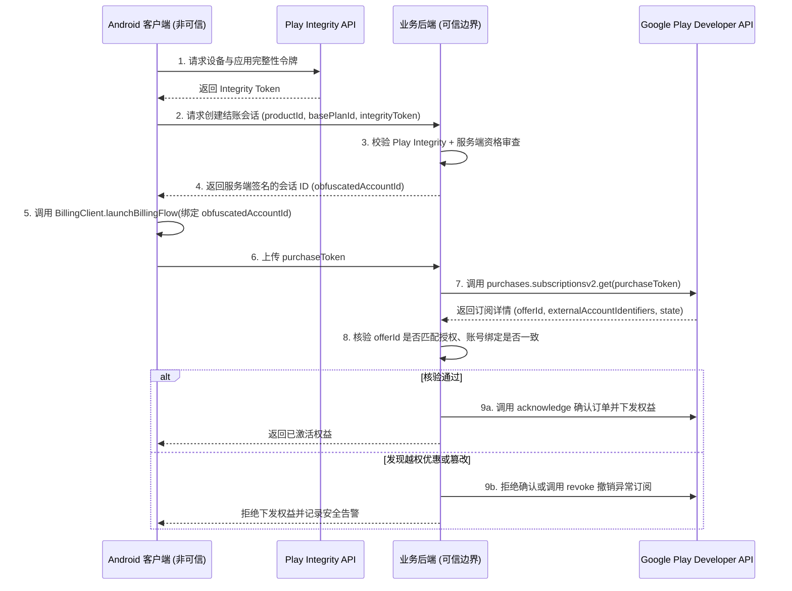

# Android Billing Security & Defense Lab

> **⚠️ 免责声明 / Disclaimer**
>
> 本项目**仅用于移动应用安全学习、架构防御研究与合规修复参考**。
> 严禁将本项目中的任何技术概念用于未授权的渗透测试、商业倒卖、薅羊毛或任何形式的攻击行为。所有代码示例均为通用防御架构演示，不包含任何针对特定第三方应用的利用代码。

---

## 背景与威胁模型

在 Android 应用内购买（Google Play Billing Library）场景中，如果业务方将**促销资格判断（Eligibility Check）**或**优惠方案选择（`offerToken` / `offerId`）**完全放在客户端本地执行，就会面临严重的**客户端可信边界缺失**风险：

1. **进程内动态插桩（Dynamic Instrumentation）风险**：攻击者可能在已 Root 或受控设备上注入插桩框架，直接获取应用进程内存中的 `BillingClient` 实例，绕过客户端 UI 限制，直接构造并调用 `launchBillingFlow()`，传入高优惠或 `$0` 试用的 `offerToken`。
2. **客户端状态篡改**：仅依赖客户端本地变量、SharedPreferences 或本地网络响应拦截来决定是否展示/允许某项订阅优惠，在客户端不可信的前提下均可被绕过。
3. **未校验优惠详情的后端确认**：如果后端在收到 `purchaseToken` 后，仅校验“订单是否支付成功”而未校验**实际生效的 `offerId` / `basePlanId` 与该用户当前是否具备对应资格**，就会导致“低价/免费试用越权开通高阶权益”的逻辑漏洞。

## 纵深防御架构（Defense-in-Depth）



## 仓库结构

```text
android-billing-defense-lab/
├── README.md                                # 项目总览与防御架构
├── LICENSE                                  # MIT 开源协议
├── docs/
│   ├── threat-model.md                      # 威胁模型与常见客户端计费漏洞分析
│   └── remediation-guide.md                 # 服务端与客户端修复加固指南
├── backend-verifier/                        # 服务端零信任校验参考实现 (Python / FastAPI)
│   ├── app.py                               # 结账会话签发、purchases.subscriptionsv2 核验与 RTDN 处理
│   ├── requirements.txt                     # Python 依赖
│   └── tests/
│       └── test_verifier.py                 # 自动化安全单元测试（含越权 offer 拦截用例）
└── android-defense-samples/                 # Android 端安全编码与 RASP 防御示例
    ├── SecureBillingManager.kt              # 安全调用 BillingClient 与服务端会话绑定示例
    ├── RaspChecks.kt                        # 应用层完整性与运行环境自检示例
    └── native-rasp.cpp                      # Native 层防调试与异常内存映射检测示例
```

## 快速运行后端校验演示与测试

```bash
cd backend-verifier
pip install -r requirements.txt
pytest -v
```

## 核心防御原则

1. **客户端零信任（Zero Trust Client）**：永远不要相信客户端传来的价格、资格状态或本地权益判断。
2. **服务端资格核验与订单核对**：通过 Google Play Developer API (`purchases.subscriptionsv2.get`) 核对实际购买的 `productId`、`basePlanId` 和 `offerId` 是否与服务端预授权一致。
3. **强制账号绑定**：使用 `obfuscatedAccountId` 将 Google Play 订单与业务系统内部用户会话强绑定，防止重放与跨账号归因。
4. **RASP 作为纵深补充**：利用 Play Integrity API 与 Native 层自检提高逆向与插桩门槛，但**绝不将 RASP 替代服务端校验**。
